# Day 7 – Windows 11 Security Policy Configuration and Deployment

After enrolling the Windows 11 VM in Day 6, I used Microsoft Intune to configure a 15-minute inactivity lock. I assigned the policy to my existing pilot group, synchronised the VM, and checked the setting in Windows using PowerShell.

## 1. Preparing the pilot group

I reviewed `SG-Intune-Pilot` in Microsoft Entra ID and checked its membership before assigning the policy. I removed the earlier test member, Aras, and updated the group for the enrolled VM and lab account.

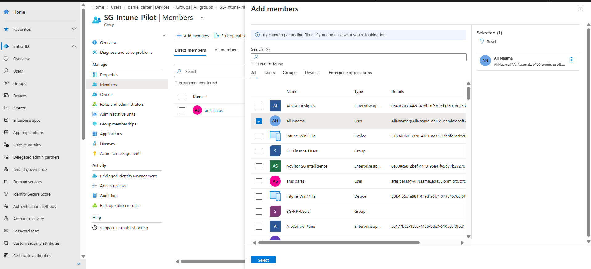
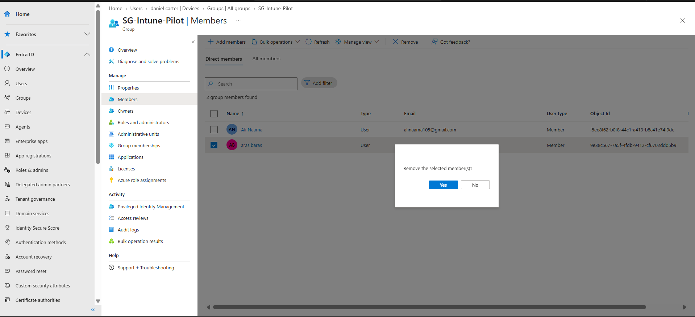
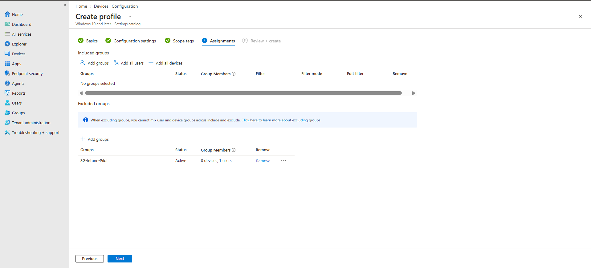

I also checked that the Windows VM was listed in Microsoft Entra ID and Intune.

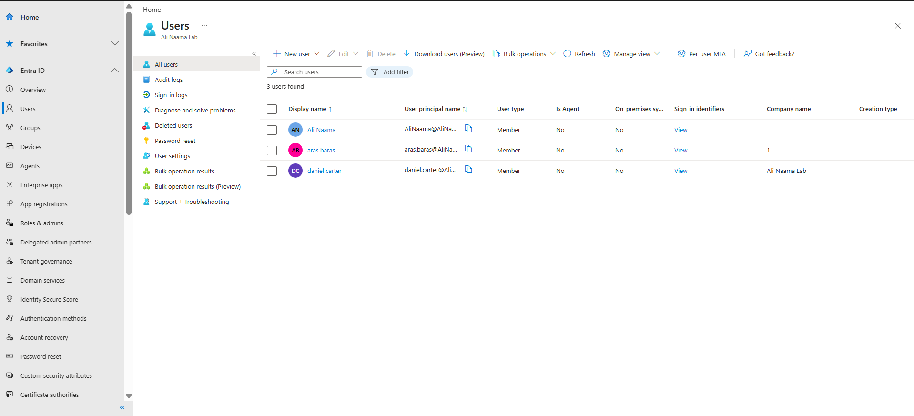

## 2. Creating the configuration profile

In **Intune Admin Center → Devices → Configuration**, I created a new policy using **Windows 10 and later** and the **Settings catalog** profile type.

I named the profile `WIN11-Pilot-Security-Baseline`.

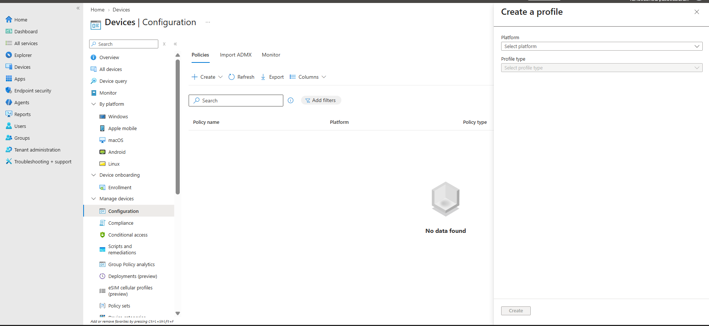
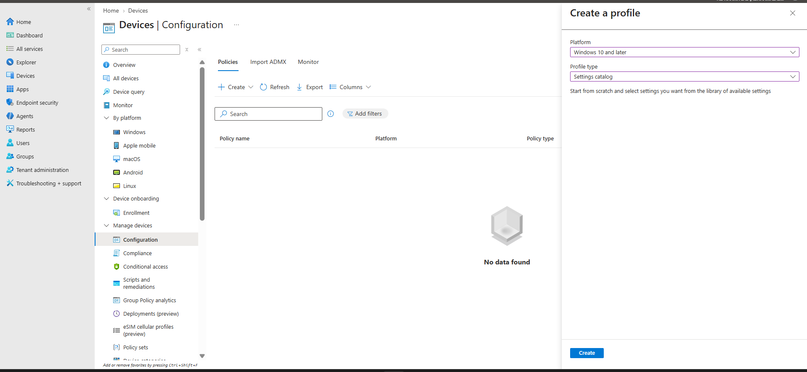
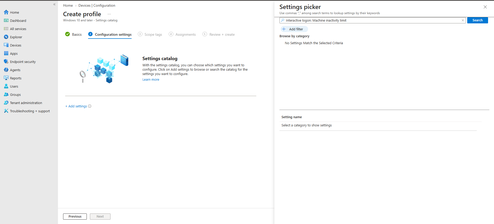

## 3. Setting the inactivity limit

Under **Local Policies Security Options**, I selected `Interactive Logon Machine Inactivity Limit` and set it to **900 seconds**.

This setting is intended to lock the Windows session after 15 minutes of inactivity.

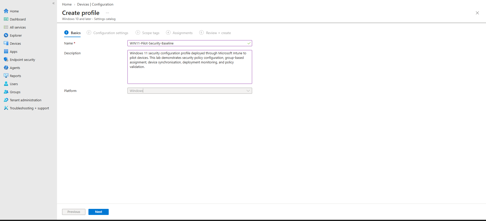
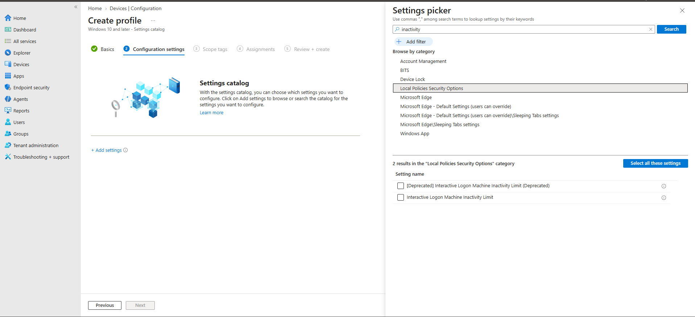

## 4. Assigning the policy

I assigned the policy to `SG-Intune-Pilot`. During setup I initially selected the group under **Excluded groups** by mistake, so I corrected it and placed the group under **Included groups**.

The final assignment had no excluded groups.

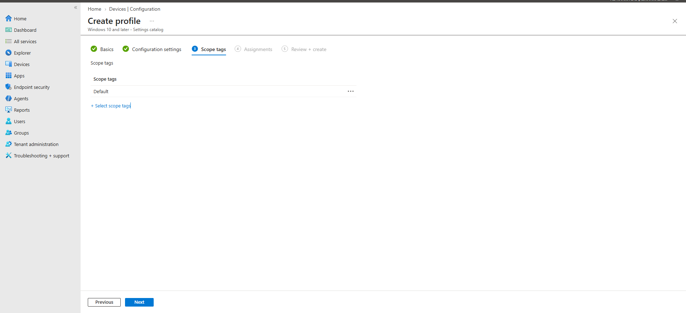
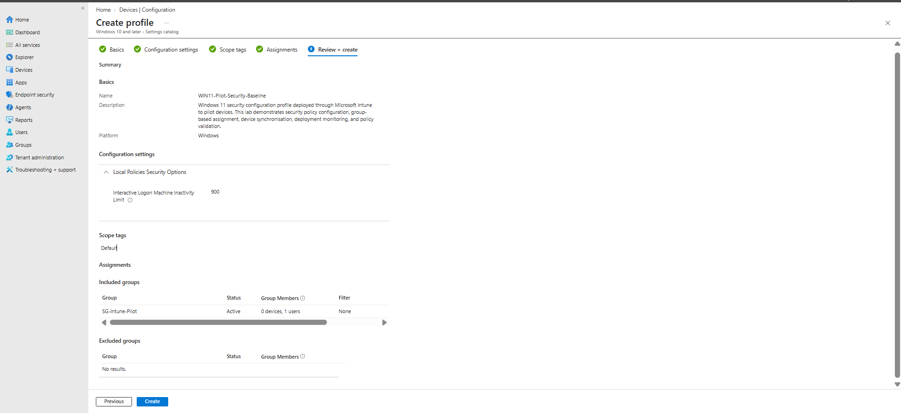

## 5. Checking the managed device

I returned to the Intune device list and checked the enrolled Windows 11 VM. The device appeared under Intune management. The device inventory and a separate compliance view did not show fully consistent compliance information, so I did not treat that as proof of a completed compliance-policy test.

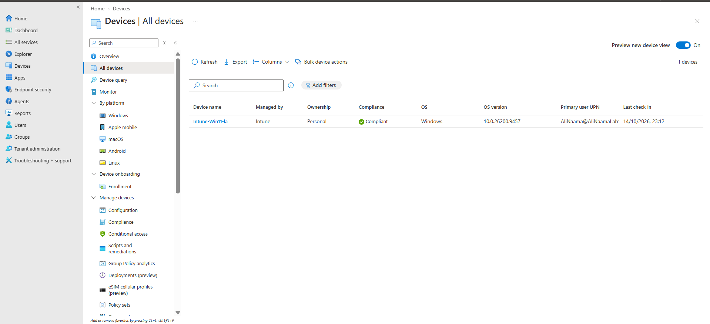
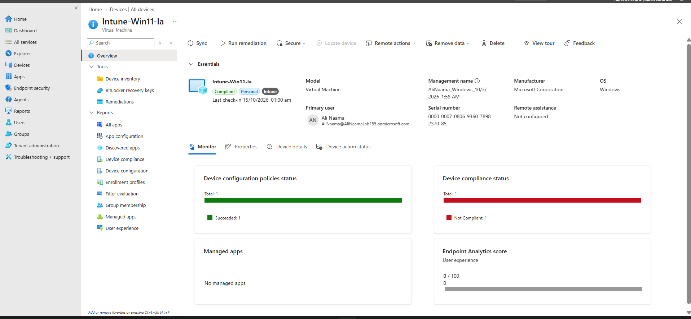

## 6. Synchronising and checking deployment

I started a manual **Sync** from the device page and then checked the configuration profile status.

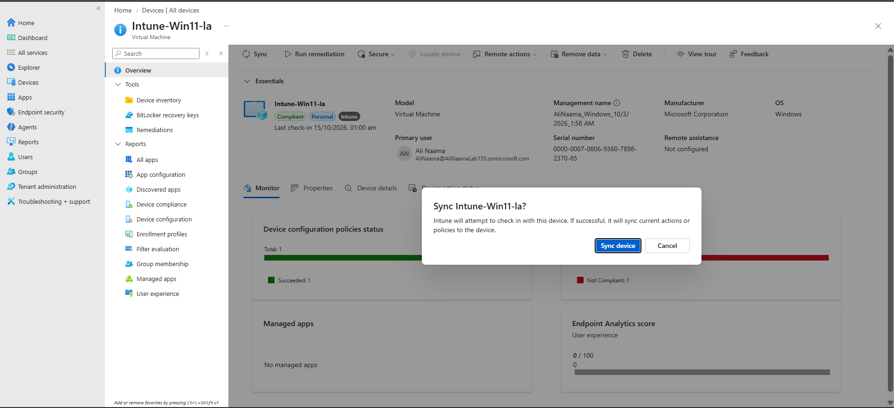
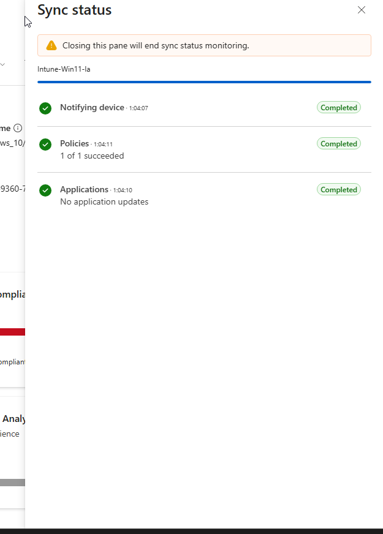
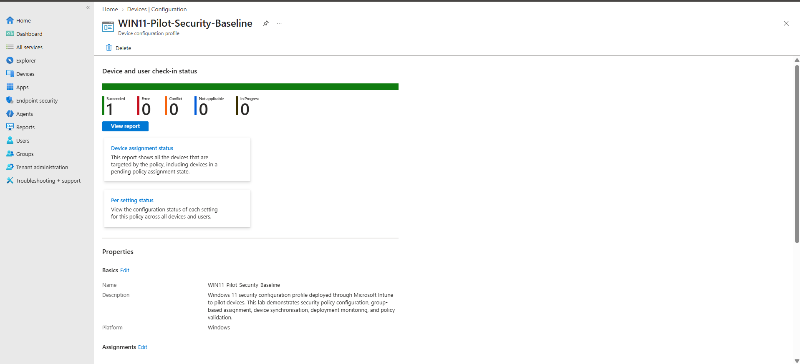

Intune reported **one successful policy deployment**, with no errors or conflicts in the policy report.

## 7. Verifying the setting in PowerShell

I checked the registry value on the Windows VM instead of relying only on the Intune report.

```powershell
Get-ItemPropertyValue -Path 'HKLM:\SOFTWARE\Microsoft\Windows\CurrentVersion\Policies\System' -Name InactivityTimeoutSecs
```

The command returned:

```text
900
```

That matched the value I had configured in Intune. It confirmed the setting was present on the VM; I did not separately record a timed 15-minute lock test.

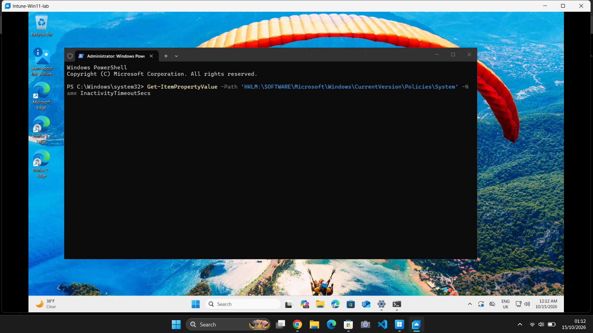

## Day 7 Summary

I created a Windows security configuration profile, assigned it to the pilot group, and synchronised the enrolled VM. Intune reported a successful deployment, and the registry check returned the expected **900-second** inactivity limit.

The main issue during the session was initially selecting the pilot group as an exclusion. I corrected the assignment before completing the deployment.


## References

- [Microsoft Learn – Create device configuration profiles in Microsoft Intune](https://learn.microsoft.com/en-us/intune/intune-service/configuration/device-profile-create)
- [Microsoft Learn – Windows device configuration settings in Intune](https://learn.microsoft.com/en-us/intune/intune-service/configuration/settings-catalog)
- [Microsoft Learn – Windows security policy setting: Interactive logon machine inactivity limit](https://learn.microsoft.com/en-us/previous-versions/windows/it-pro/windows-10/security/threat-protection/security-policy-settings/interactive-logon-machine-inactivity-limit)
- [Microsoft Learn – Sync devices with Microsoft Intune](https://learn.microsoft.com/en-us/intune/intune-service/remote-actions/device-sync)
