# Day 9 – Windows Application Deployment Using Microsoft Intune

**Lab date:** 26 October 2026  
**Platform:** Microsoft Intune and Microsoft Entra ID  
**Exercise:** Microsoft Store app (new) – Company Portal  
**Outcome:** Application configured and assigned; endpoint installation not tested

## Overview

This practical exercise documents how a Windows application can be added to Microsoft Intune, configured with meaningful administrative information and published to a targeted Microsoft Entra ID group. The example application is **Microsoft Company Portal**, a self-service interface that can help users discover applications made available by their organisation.

The objective is to demonstrate the **management-side application deployment workflow**: application discovery, publisher verification, property configuration, pilot-group targeting, assignment selection and initial monitoring. This is a configuration exercise rather than a claim of a completed Windows 11 installation.

## Learning objectives

- Navigate the Intune Windows application catalogue and create an application entry.
- Use **Microsoft Store app (new)** to locate an application from a verified publisher.
- Review installer type, package identifier, installation behaviour and ownership metadata.
- Compare **Required**, **Available for enrolled devices** and **Uninstall** assignments.
- Target an application to a Microsoft Entra ID pilot security group.
- Distinguish successful configuration from installation verification.

## Lab configuration

| Item | Recorded configuration |
| --- | --- |
| Application | Company Portal |
| Publisher / developer | Microsoft Corporation |
| Source | Microsoft Store app (new) |
| Installer type | UWP |
| Package identifier | `9WZDNCRFJ3PZ` |
| Install behaviour | User |
| Administrative owner | IT Administration |
| Target group | `SG-Intune-Pilot` |
| Final assignment | Available for enrolled devices |
| Installation validation | Not performed |

The numbered images below are retained as the original lab evidence and embedded **at the point where each configuration stage is explained**, rather than in a separate screenshot gallery.

## 01. Accessing Intune application management

I began in the Microsoft Intune admin center and navigated to **Apps → Windows → Windows apps**. This area is used to maintain the Windows application catalogue, create deployment entries, inspect assignment configurations and review reported installation outcomes.

Centralising application administration is useful because endpoint software can be governed through consistent settings instead of being installed independently on each computer. An administrator can identify the intended application, select its audience and monitor the resulting deployment from a common console.

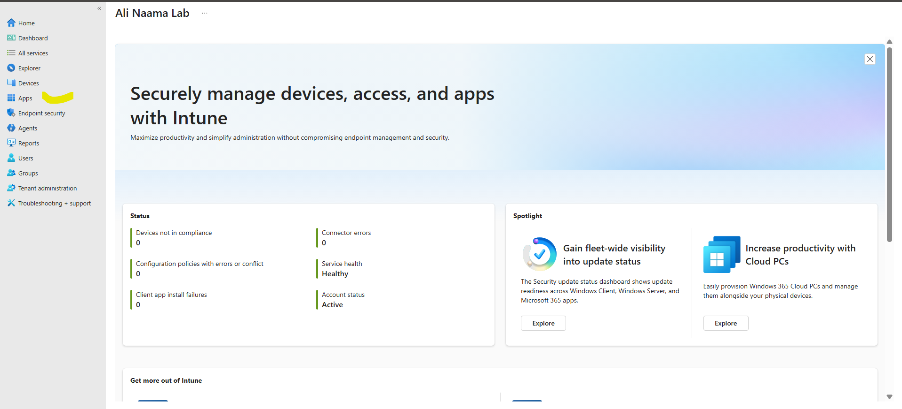

*Evidence 01: Intune administration interface.*
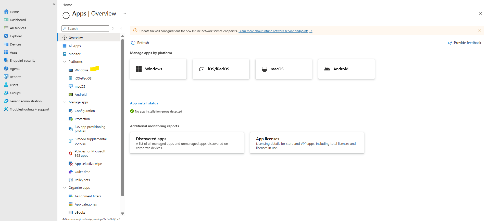

*Evidence 02: Navigation to Windows application management.*
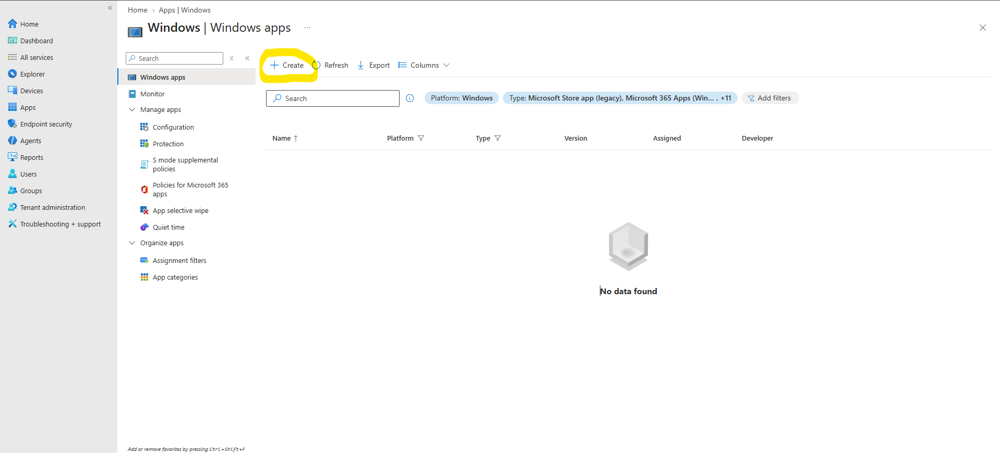

*Evidence 03: Windows apps management view.*

## 02. Creating an application entry

From the Windows apps page I selected **Create** to start the application wizard. Intune supports several application types, including Win32 packages and Microsoft Store applications. Choosing the correct type matters because package requirements, installation behaviour, detection and reporting vary by type.

For this exercise, I selected **Microsoft Store app (new)**. This integration makes supported Store applications discoverable through the Intune workflow without manually preparing a traditional Win32 installer. The application still needs suitable assignment and device eligibility before a user can install it.

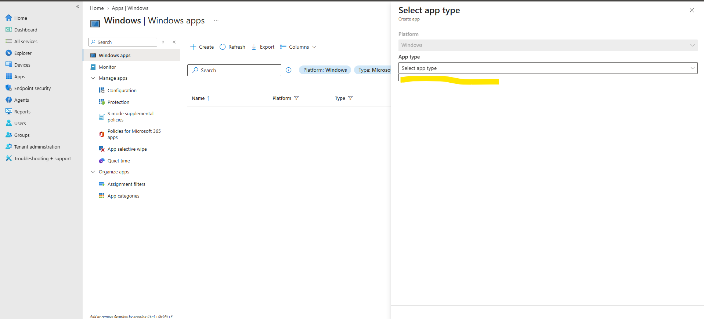

*Evidence 04: Starting a new Windows application.*
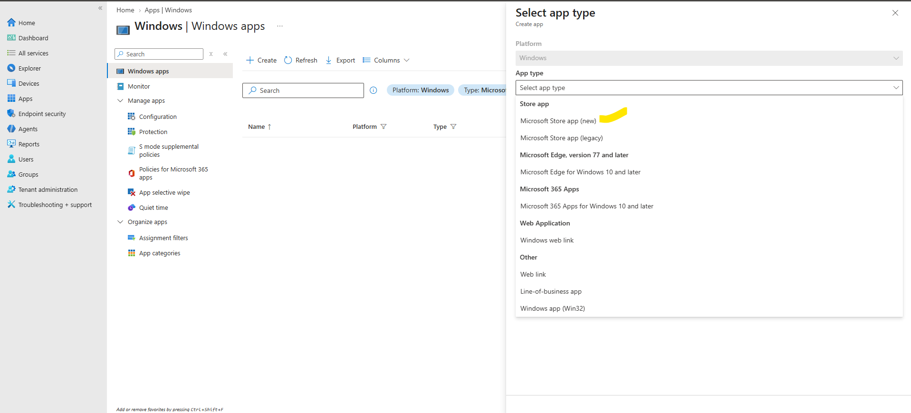

*Evidence 05: Reviewing the application type selection.*
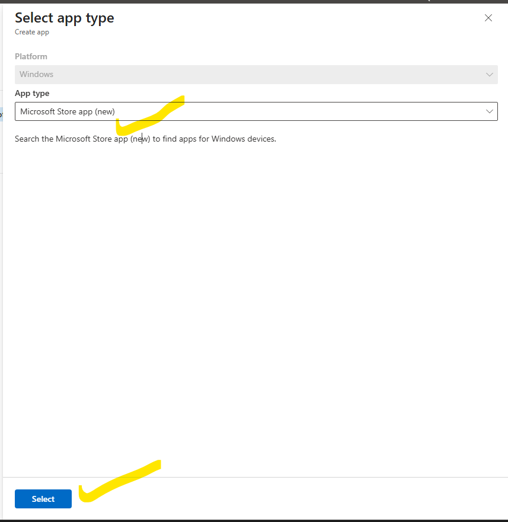

*Evidence 06: Selecting Microsoft Store app (new).*

## 03. Discovering Microsoft Company Portal

I opened the Microsoft Store search interface and searched for **Company Portal**. I selected the entry published by **Microsoft Corporation**, rather than assuming any similarly named result was the correct application.

Publisher verification is an important administrative habit. It helps prevent selecting an unintended application and improves the quality of the software inventory. Company Portal is Microsoft's end-user interface for discovering organisational applications and accessing supported device-management information.

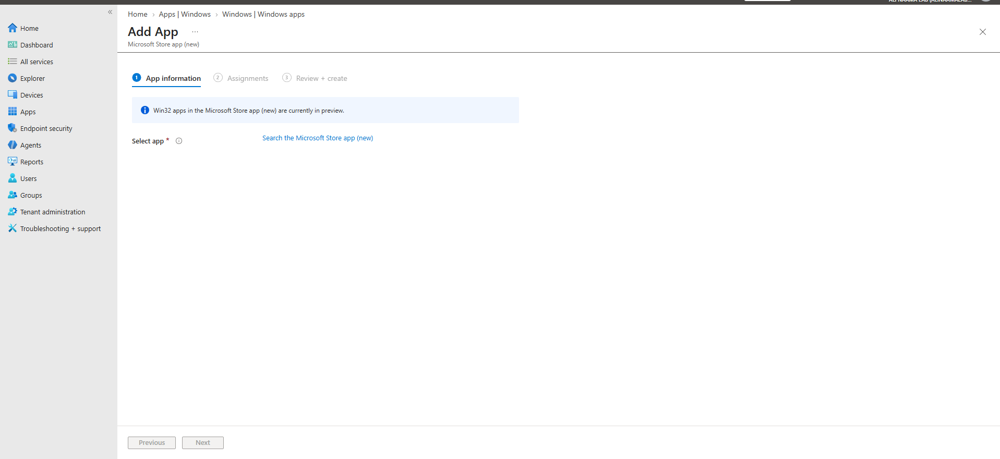

*Evidence 07: Microsoft Store application search.*
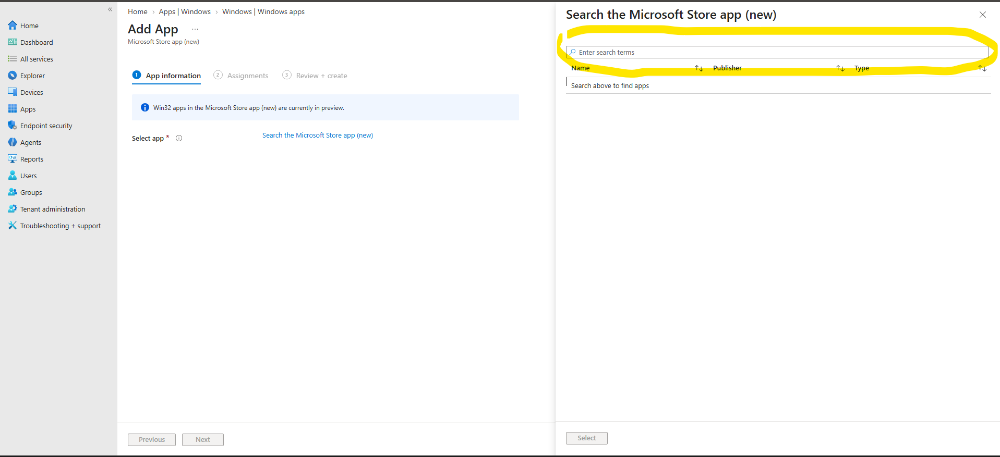

*Evidence 08: Searching for Company Portal.*
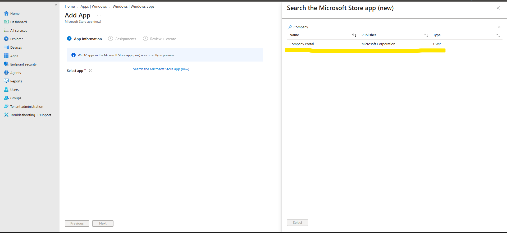

*Evidence 09: Selecting the Microsoft Corporation Company Portal listing.*

## 04. Reviewing application information

After selecting Company Portal, I reviewed the information imported into the wizard. The recorded application uses the **UWP** installer type, package identifier `9WZDNCRFJ3PZ` and **User** install behaviour. The administrative metadata recorded **Microsoft Corporation** as developer and **IT Administration** as owner.

Application metadata is not just descriptive. It allows other administrators to recognise what was approved, who owns the configuration and what deployment assumptions apply. In this lab, the notes explicitly identify the Day 9 exercise and state that installation was **not tested**. That distinction matters when screenshots are later used as portfolio evidence.

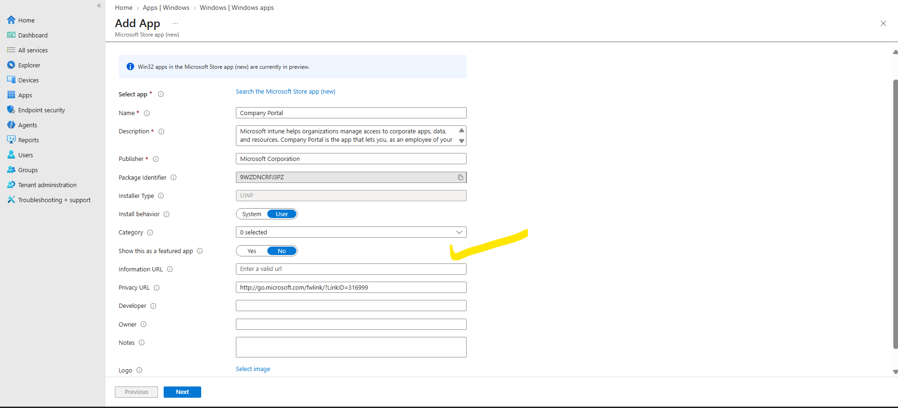

*Evidence 10: Reviewing Company Portal application information.*
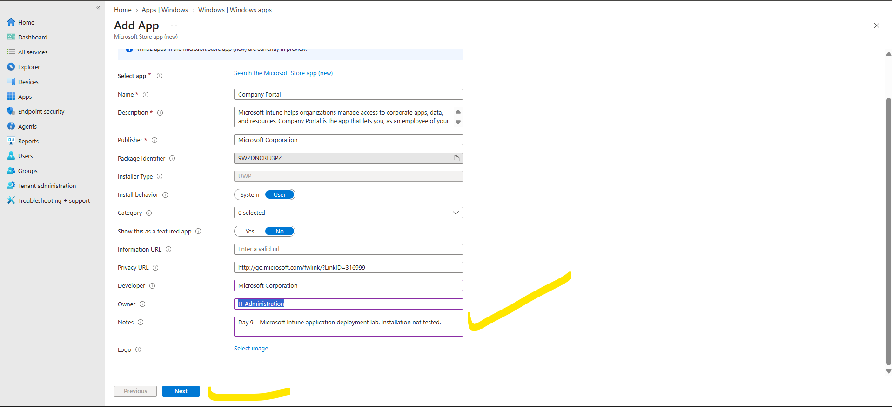

*Evidence 11: Checking publisher and application properties.*
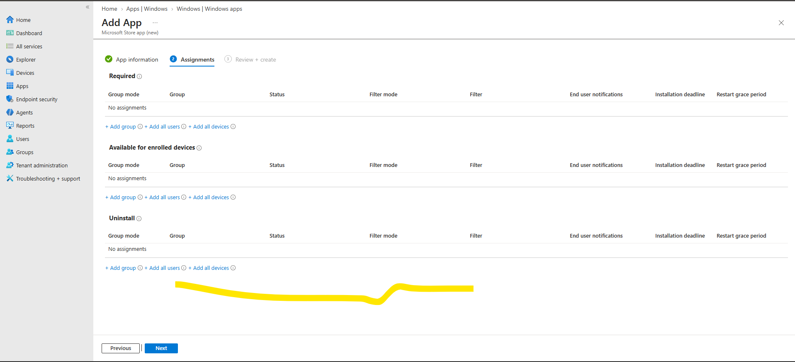

*Evidence 12: Recording administrative metadata and install behaviour.*

## 05. Understanding deployment assignment types

The **Assignments** stage determines how the app is offered to the target population. Intune distinguishes three important assignment intentions:

| Assignment | Meaning |
| --- | --- |
| **Required** | Intune attempts to install the application automatically for applicable targets. |
| **Available for enrolled devices** | Eligible targeted users can choose to install the application through the supported Company Portal experience. |
| **Uninstall** | Intune attempts to remove an applicable application from targeted devices. |

A required deployment and an available deployment are not interchangeable. An administrator must decide whether the application is mandatory or optional. During this lab the assignment configuration was reviewed and the intended final choice was **Available for enrolled devices**, not Required.

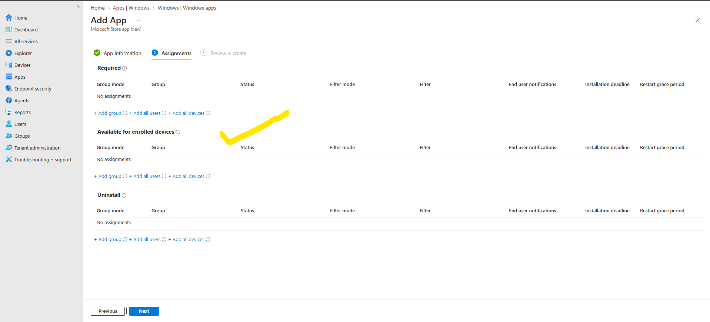

*Evidence 13: Opening application assignments.*
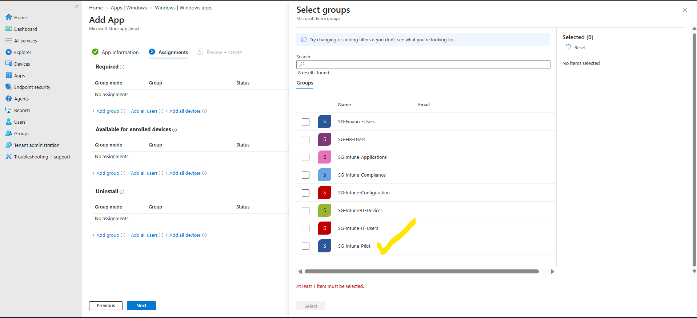

*Evidence 14: Reviewing group assignment controls.*
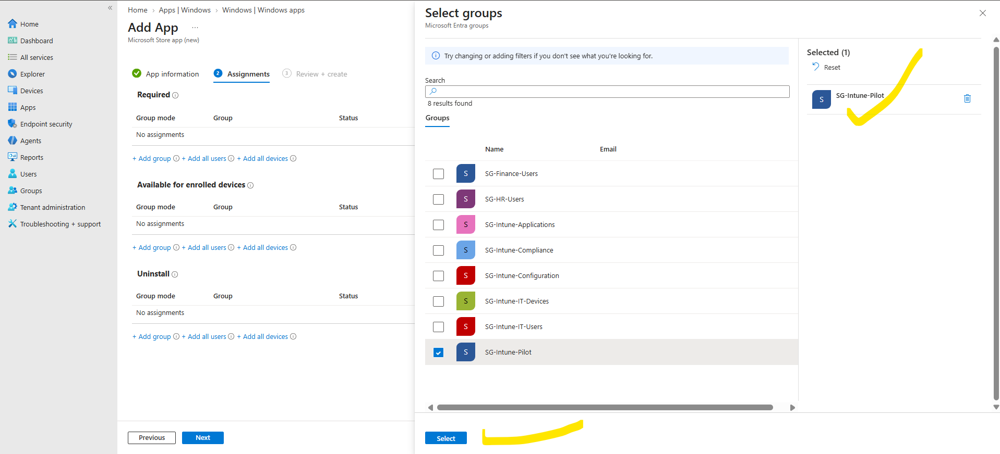

*Evidence 15: Comparing available assignment methods.*

## 06. Targeting the Entra ID pilot group

I targeted the application to the Microsoft Entra ID security group **`SG-Intune-Pilot`**. Group-based assignment is a practical way to scope application availability to a controlled audience. In a larger organisation, a pilot deployment can be used to limit the blast radius of configuration mistakes and gather feedback before broad release.

The final assignment was **Available for enrolled devices**. This means the configuration publishes the app to the intended eligible audience; it does **not** prove the app has been installed. Availability also depends on the supported platform, enrolment, targeting and the user's access to Company Portal.

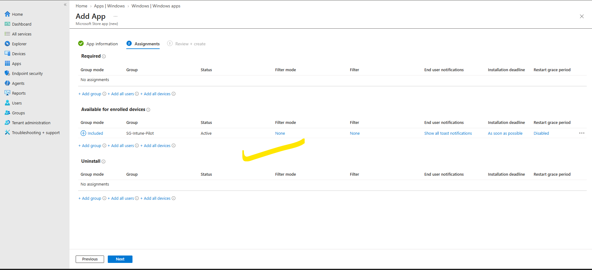

*Evidence 16: Selecting the Microsoft Entra ID pilot group.*
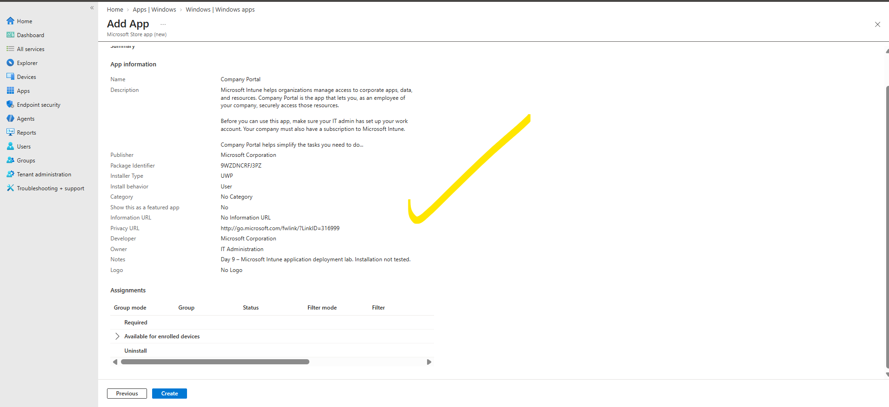

*Evidence 17: Reviewing the final available assignment.*

## 07. Reviewing and creating the app

Before completing the wizard, I reviewed the selected application, its properties and the assignment target. This review is a simple but valuable change-control practice: an incorrect target group or assignment type can affect devices or users outside the intended pilot.

The Company Portal application entry was then created in Intune. Creating the entry confirms that the management-side configuration was saved; it should not be described as a completed endpoint installation.

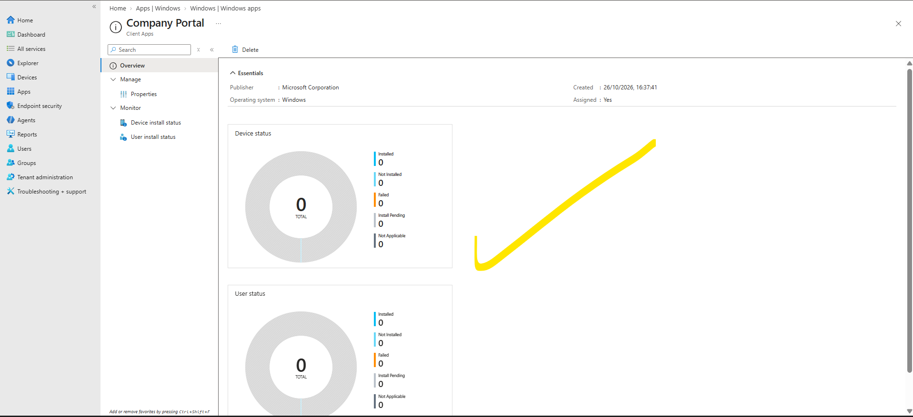

*Evidence 18: Company Portal application creation and overview.*

## 08. Properties and installation monitoring

I returned to the application's overview and properties to inspect the configured assignment and the initial monitoring view. At the point captured, the reported counts were **0 installed, 0 failed, 0 pending and 0 total**. These numbers show that the captured monitoring view did not yet provide installation results. They are **not** evidence of successful installation, nor by themselves evidence of a deployment failure.

In operational environments, Intune monitoring can help administrators identify devices that report installation success or errors and determine where additional investigation is required. Report interpretation must consider assignment type, reporting delays, eligibility and whether an installation has actually been attempted.

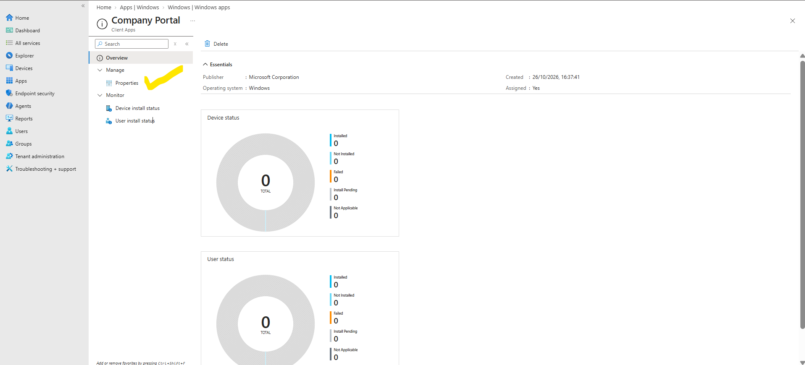

*Evidence 19: Reviewing Company Portal application properties.*
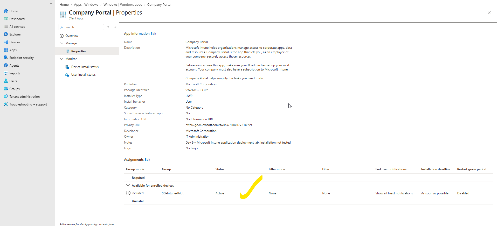

*Evidence 20: Inspecting initial installation monitoring.*

## Security and operational considerations

**Controlled software distribution.** Publishing approved applications through Intune provides a repeatable administrative mechanism for managing what is offered to enrolled endpoints. The presence of an app in the catalogue is not itself a security guarantee; organisations still need software review and lifecycle controls.

**Identity-based targeting.** Microsoft Entra ID security groups define the intended deployment population. Administrators should verify group membership and avoid broad assignments when testing a new configuration.

**Deployment change control.** Reviewing the final assignment before creation helps prevent accidentally making an optional application mandatory. Documenting the target group, deployment type and app owner supports operational handover.

**Evidence integrity.** The screenshots support the steps performed in the console. They do not show a confirmed installation on a Windows 11 device. The lab therefore reports configuration and assignment as completed, while explicitly leaving installation validation outstanding.

## Troubleshooting checklist for a future device test

If a targeted user cannot find or install Company Portal, a future test should verify that the Windows device is enrolled and communicating with Intune; the correct user is a member of the targeted group; the assignment is saved and applicable; the app supports the device platform; and the user can access the relevant Company Portal experience. Intune's app installation reports and device-side management logs can then be reviewed for actionable errors.

These are **recommended future checks**, not actions performed or validated during Day 9.

## Skills demonstrated

This exercise provides evidence of Intune application catalogue administration, Microsoft Store application discovery, application property configuration, Entra ID group targeting, assignment-method selection and initial deployment monitoring. It also demonstrates clear technical documentation and the ability to separate configured state from tested state.

## Result and limitations

**Completed:** Created the Company Portal application entry in Intune and assigned it to `SG-Intune-Pilot` as **Available for enrolled devices**. Reviewed its properties and initial monitoring screen.

**Not completed:** Installation on an enrolled Windows 11 endpoint, confirmation that Company Portal appears to the targeted user, and validation of a successful installation status. These should not be claimed as completed.

## Microsoft Learn references

- [Add Microsoft Store apps to Microsoft Intune](https://learn.microsoft.com/en-us/intune/intune-service/apps/store-apps-microsoft)
- [Assign apps to groups with Microsoft Intune](https://learn.microsoft.com/en-us/intune/intune-service/apps/apps-deploy)
- [Monitor app information and assignments](https://learn.microsoft.com/en-us/intune/intune-service/apps/apps-monitor)

